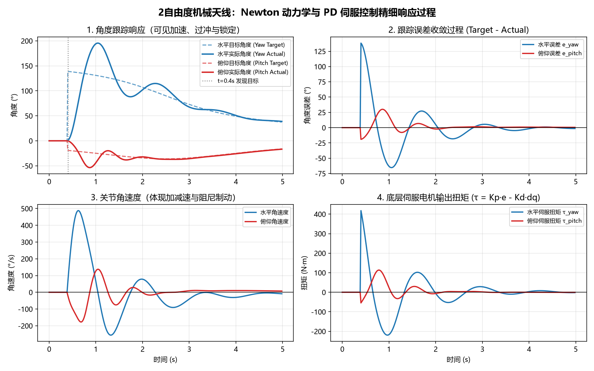
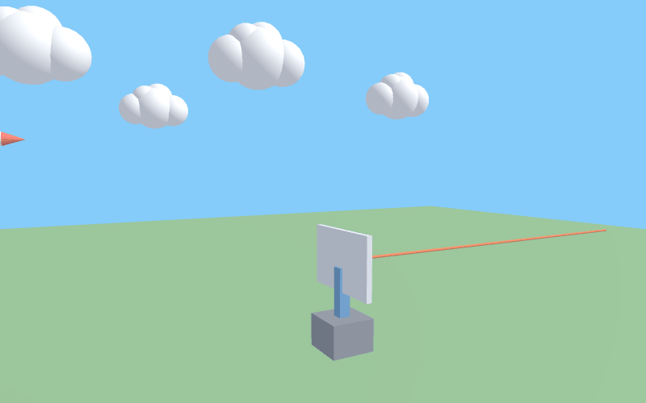

# 2自由度机械天线仿真与伺服控制（Newton + OpenUSD + Pyrender）

本项目基于 **Newton（NVIDIA Warp + SolverMuJoCo）**、**OpenUSD** 与 **Pyrender**，搭建了 2 自由度机械天线（矩形锅盖）的刚体动力学仿真、PD 位置伺服控制以及目标追踪可视化闭环。

## 目录结构

- `assets/antenna_2dof.usda`：标准 OpenUSD 物理资产（包含立柱、矩形锅盖刚体与两个正交旋转关节及其伺服驱动参数）
- `my_antenna_from_usd.py`：从 OpenUSD 资产一行代码导入天线，执行分阶段单轴控制（先水平转 60° 停稳等待 → 再垂直俯仰 60° 停稳等待）
- `my_antenna.py`：纯 Python `ModelBuilder` 构建版原型
- `newton_pyrender_servo_demo.py`：Newton 真实动力学 + PD 伺服追踪飞行目标 + Pyrender 离屏渲染动画与四合一控制曲线生成
- `pyrender_antenna_demo.py`：Pyrender 蓝天白云场景与深度图渲染示例

## 效果预览

### 动力学与 PD 伺服控制曲线


### 带指向波束的双轴联动追踪动画


## 环境配置与运行

```bash
# 1. 创建并激活虚拟环境（Python 3.11+）
python -m venv .venv
.\.venv\Scripts\Activate.ps1

# 2. 安装依赖
pip install -r requirements.txt
pip install PyOpenGL==3.1.10

# 3. 运行 OpenUSD 导入版分阶段控制仿真
python my_antenna_from_usd.py

# 4. 运行 Newton + Pyrender 动力学追踪与曲线生成
python newton_pyrender_servo_demo.py
```
